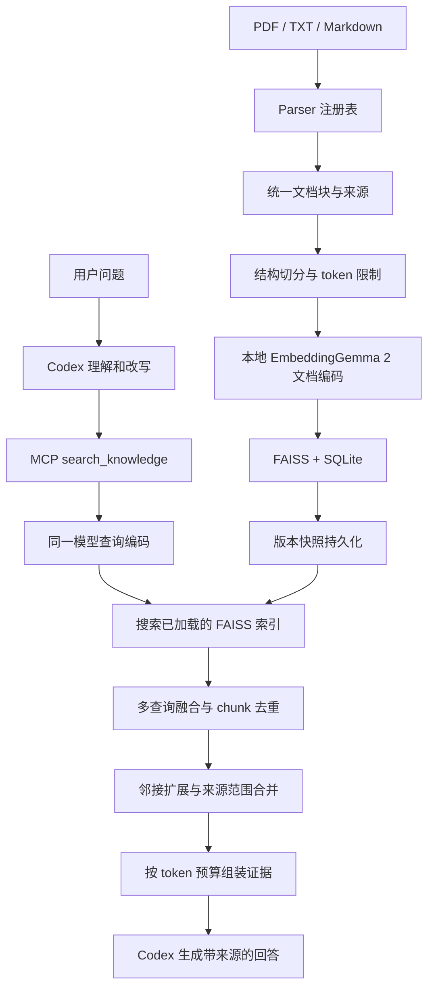

# 本地 RAG 流水线设计

状态：学习版已实现，具体测试结论见 reports/TEST_REPORT.md。2026-10-14。

## 已确认并实现的学习版

后续选择覆盖下文早期设计中的 MCP 入口和 query 改写方案；当前实现以 README 和代码为准。

- 输入仅支持 TXT / Markdown，使用 25 组 AI/RAG 真实历史问答。
- 在终端一次运行并分阶段完整打印结果；通过官方 Codex Python SDK 生成答案。
- 仅使用原始 query，不改写；FAISS 向量检索与 jieba 分词的 BM25 关键词检索按加权 RRF 融合。
- 问答为 chunk 的父级单位，长问答使用 LangChain RecursiveCharacterTextSplitter 递归多级切分，以 embedding tokenizer 限制完整输入，并保留问题、重叠和字符范围。
- Retriever：FAISS + BM25 双路候选召回 → RRF 融合 → MMR 去冗余选择 → 精确去重 → 同组问答补全或范围合并 → 上下文预算。
- 存储层支持指纹及完整性检查通过后复用索引，BM25 从同一快照在内存重建；当前命令行入口每次重建。
- 终端打印检索证据，详细 prompt 可通过 --output-json 保存；仅依据检索证据回答、标注引用、证据不足则说明。
- 学习版不提供元数据过滤；以后加入过滤时必须先定义候选集合内检索语义。
- 解析、建库或发布失败保留上一成功快照，但不自动用与当前输入不匹配的旧缓存回答。
- 上下文使用独立的 `o200k_base` 估算；证据预算不等于完整 SDK 请求窗口。

当前模块：`schemas.py`、`document_parser.py`、`chunker.py`、`embedder.py`、`vector_store.py`、`lexical_index.py`、`retriever.py`、`context_builder.py`、`codex_adapter.py`，由 `run.py` 编排。MCP、PDF/OCR 是后续学习方向，本版未实现。

## 早期设计参考

## 目标和第一版选型

从 PDF、TXT、Markdown 导入知识库，使用已下载的 Google EmbeddingGemma 2 在本机计算向量，以 Codex 作为问答入口、查询规划与答案生成执行端。

| 模块 | 第一版方案 |
| --- | --- |
| 核心流水线 | Python |
| 文档解析 | parser 注册表，PDF / TXT / Markdown 分别实现 |
| Chunk | 按标题、段落、句子切分，再使用模型 tokenizer 限制长度 |
| Embedding | 本地 `google/embeddinggemma-2`，768 维、float32、L2 归一化 |
| 向量索引 | FAISS `IndexFlatIP`，精确内积检索 |
| 文本与元数据 | SQLite，保存来源、chunk、版本与索引 ID 映射 |
| 磁盘持久化 | 每个 generation 保存 FAISS、SQLite、manifest；发布时切换 CURRENT |
| Codex 接入 | 本地 RAG MCP server 暴露 `search_knowledge` |

FAISS 是向量检索库，不是完整数据库。本方案用 FAISS + SQLite 组成第一版本地存储层。归一化向量的内积等于余弦相似度。第一版选择精确检索便于验证；后续根据实际规模和延迟评估 HNSW 等索引，不预设迁移阈值。

已检查的模型目录：

```text
/Users/noodles/Documents/Codex/2026-10-06/h/outputs/models/embeddinggemma-2
```

当地下载 manifest 中的 revision 为 `914f7f89142e33e77833254d9c9b90c3cef7303b`。本次核对了目录、权重文件存在和模型配置，没有重新校验权重哈希，也没有重新运行模型。

## 两条流水线



生产端构建索引；消费端加载已经发布的索引，然后计算 query 向量并搜索。消费端不重新计算文档向量、不重新建立索引。启动时加载模型一次，在后续请求中复用。

## 生产端

1. **发现与识别文件**：根据文件类型选择 parser；记录路径、内容哈希和解析状态。不支持的类型给出明确错误。
2. **统一解析输出**：每个 parser 返回有顺序的 `DocumentBlock`，保留段落、标题、表格、页码和来源定位。TXT 处理 BOM 与编码错误；PDF 区分可提取文本与扫描页。扫描页没有 OCR 时标记“需要 OCR”，不能当作成功导入的空文档。
3. **清洗**：规范换行和空白，保留标题、列表、表格及有意义的段落边界。页眉页脚清理须保守，避免删除正文。
4. **切分**：先按标题、段落，再按句子和 token 长度；建议初始上限 512 tokens、重叠约 64 tokens，均为待评估参数。长度包括 embedding 使用的标题和前缀，避免模型静默截断。保留顺序号、原文字符范围和跨页来源跨度。
5. **文档编码**：批量编码 chunk。无标题用 `prompt_name="Document"`；有标题按 `title: {title} | text: {content}` 格式编码，不重复添加 Document 前缀。统一 float32、768 维、归一化；拒绝非有限值和零向量。
6. **存储与发布**：文本及来源写入 SQLite；向量与 ID 写入 FAISS。完成一致性检查后发布新 generation。

Parser 的接口建议为 `parse(path) -> list[DocumentBlock]`，新类型只需增加实现和注册，不改变后续流程。PDF 可先评估 pypdf；复杂表格、阅读顺序和 OCR 作为专门解析能力扩展，不宣称一个基础 parser 能正确处理所有 PDF。

## 消费端

1. **查询规划**：Codex 从原始问题和必要对话上下文中生成 1–3 条语义完整的查询，保留人名、金额、时间和否定条件。原始问题与改写查询一起检索，降低改写偏移风险。
2. **查询编码**：同一模型、revision、维度、归一化规则，使用查询任务前缀 `SearchQuery`。文档和查询的任务前缀按角色分别设置，无需强行使用完全相同的输入前缀。
3. **召回**：每条查询建议先返回 top-20 候选。关键词可以用于明确的文档过滤；若需要关键词检索效果，应另建全文检索通道，不能把向量库当作关键词倒排索引。
4. **融合与去重**：多查询使用 RRF 等按排名融合的方法；按 chunk ID 去重。同内容的多个来源合为一条证据时保留全部来源，不因相似度高就删除可能不同的事实。
5. **扩展与合并**：必要时补充命中 chunk 的前后邻居；仅在同一文档、同一版本、相邻或重叠原文范围内合并。根据原文范围取并集，消除 overlap 的重复字符。不同文件或不相邻段落保持独立证据。
6. **预算与生成**：在可配置证据预算内保留最相关内容，建议从 6000 tokens 起评估，并为系统提示、历史对话和回答预留空间。把原始问题、证据编号、内容、文件名、页码或段落位置传给 Codex。答案引用证据；不足或冲突时明确说明。

top-k、chunk 长度、重叠和证据预算都是起始设置，不代表已验证最优。余弦分数不是正确答案概率，拒答阈值应通过真实问题评估后确定。

## Codex 接入

### 在 Codex 中直接询问（推荐先实现）

Codex 本身完成查询理解、改写与最终回答。为它配置一个本地 RAG MCP server：

```text
用户 → Codex → search_knowledge → 本地检索流水线
                    ↑                   ↓
                    └──── 结构化证据 ────┘
用户 ← 带来源回答 ← Codex
```

`search_knowledge` 内部负责 embedding、召回、融合、去重、合并和预算控制；它返回证据，不负责再次调用 Codex。无需嵌套“Codex 调用 Codex 改写”才能实现此流程。

建议工具输入：

```json
{
  "original_query": "刚入职一年能休几天？",
  "queries": ["员工工作满一年后的年休假天数和适用条件"],
  "top_k": 20,
  "filters": {},
  "max_context_tokens": 6000
}
```

建议工具输出字段：`generation`、`retrieval_status`、`evidence[]`、`warnings[]`。每条证据包含 `citation_id`、`text`、`sources[]`、命中 chunk ID、原始检索排名与分数、是否经过邻接扩展。空结果和检索错误分别表示。

工具约束 top-k 和证据预算，过滤条件经过允许字段校验。知识库文本作为证据数据处理，其中的指令不改变工具行为或系统提示。

### 独立应用调用 Codex

若后续需要自己的 CLI、Web API 或前端，增加 `CodexAdapter`，通过官方 Codex SDK 或 app-server 管理模型调用。可以由 Codex 在工具循环中检索，也可以显式分两步：查询改写 → 本地检索 → 携证据生成回答。

显式改写输出应采用结构化格式并校验；失败时回退原始问题。保留生成接口抽象，核心 parser、embedding 和检索模块不依赖 Codex 会话生命周期。账号能否完成实际调用须在接入时验证，本次没有调用或验证账号权限。

## 数据与版本一致性

最小字段：

| 对象 | 核心字段 |
| --- | --- |
| Document | doc_id、source_path、content_hash、version、parser_version、status |
| DocumentBlock | doc_id、block_id、type、text、order、source_spans、heading_path |
| Chunk | chunk_id、doc_id、document_version、ordinal、text、source_spans、start/end、token_count、content_hash |
| Vector 映射 | vector_id、chunk_id；vector_id 是 FAISS 返回的整数 ID |
| Manifest | generation、embedding_model/revision、dimension、dtype、normalization、query/document 模板、chunker_version、metric、index_type、counts、文件校验值 |

查询启动时核对 manifest 与当前 embedding 配置；模型权重版本、维度或编码模板变化时新建索引，不能将新旧向量混入同一检索空间。chunker 或 parser 改变时，受影响文档重新解析、切分和索引。

建议磁盘布局（设计，不代表已创建）：

```text
data/
  generations/
    <generation>/
      vectors.faiss
      metadata.sqlite
      manifest.json
  CURRENT
```

第一版每次构建完整一致快照：

- 相同内容哈希且流水线版本相同的文档可复用解析结果和向量。
- 更新文档以新版本替换；已删除文件的旧 chunk 不进入新快照。
- 写入临时 generation，完成 SQLite 提交、关闭写连接、写入 FAISS 和 manifest。
- 检查向量数、chunk 数、ID 映射、文件校验值和一个实际查询后，在同一文件系统原子替换 CURRENT；需要断电恢复保证时同步文件及目录。
- 查询请求固定使用一个已打开的 generation，避免一次请求跨版本读数据；新 generation 加载成功后供后续请求使用。旧快照保留到读者释放，支持回退。

## 建议模块划分与实现顺序

在现有 `01-simple_rag` 中逐步增加以下模块，而不是先引入多个独立服务：

```text
rag/
  document_parser.py  # 注册表与 parser 接口
  schemas.py          # 文档块、chunk、证据结构
  chunker.py          # 结构及 token 切分
  embedder.py         # 本地模型、文档与查询编码
  vector_store.py     # FAISS、SQLite、generation
  ingest.py           # 生产端编排
  retriever.py        # 召回与多查询融合
  context_builder.py  # 去重、邻接合并、证据预算
  mcp_server.py       # Codex 检索工具
  codex_adapter.py    # 独立应用接入时再增加
```

1. TXT / Markdown 导入、chunk、embedding、存盘和重启检索。
2. PDF 解析与可追溯来源，扫描页明确失败或转入 OCR。
3. 去重、邻接合并和 token 预算。
4. MCP 接入 Codex，验证带来源回答。
5. 用真实语料测 Recall@k、引用正确性、无法回答的问题、延迟，以及更新和删除后的检索结果。

本机既有实验曾遇到 PyTorch / FAISS 的 OpenMP 冲突，可沿用启动前 `OMP_NUM_THREADS=1`、`MKL_NUM_THREADS=1` 和各库线程数设为 1 的已知规避方法；正式实现仍需验证。不能把之前的小样例检索成功当作本项目问答质量验证。

## 参考资料

- [Google EmbeddingGemma 2 模型说明](https://huggingface.co/google/embeddinggemma-2)：模型、任务前缀、文档标题格式和数值精度。
- [FAISS 索引](https://github.com/facebookresearch/faiss/wiki/Faiss-indexes)：IndexFlatIP 与余弦检索。
- [FAISS 索引持久化](https://github.com/facebookresearch/faiss/wiki/Index-IO,-cloning-and-hyper-parameter-tuning)。
- [Codex MCP](https://learn.chatgpt.com/docs/extend/mcp?surface=cli)：本地 STDIO 与 HTTP MCP 接入。
- [Codex SDK](https://learn.chatgpt.com/docs/codex-sdk)：应用程序调用 SDK / app-server。
