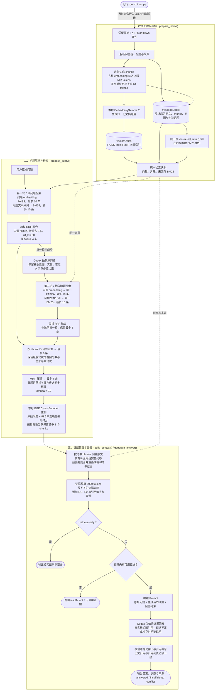

# 基础 RAG 全流程

对应本目录的基础 RAG 封板实现。下图使用默认参数，候选数量均为上限；两轮检索按顺序执行，并共用同一索引快照。

## 数据处理与存储

先统一切块，再为同一批 chunks 建立两路检索能力。Embedding 模型负责把文本编码成向量；BM25 是关键词检索算法，两者都不负责切块。

磁盘快照包含 `vectors.faiss`、`metadata.sqlite` 与 `manifest.json`，通过 `CURRENT` 指向当前版本。FAISS 文件保存向量索引，SQLite 保存解析后的文档、chunks 与映射关系。BM25 不单独保存索引文件，而是在创建或加载快照时，由 SQLite 对应的同一批 chunks、标题与本组问题在内存中构建。

当前命令行入口强制重建索引；底层存储仍支持指纹校验和缓存复用。

## 问题解析与检索

第一轮使用原始问题，第二轮使用 Codex 抽象后的问题。每轮都先执行向量与 BM25 两路召回，再用 RRF 按排名融合；两轮结果合并时按 chunk ID 去重，不直接累加两轮的原始分数。

MMR 使用最强命中轮次的召回相关性，以及候选 embedding 之间的余弦相似度，压缩重复内容。随后，`BAAI/bge-reranker-base` Cross-Encoder 对“原始问题 + 候选文本”联合打分。Cross-Encoder 分数不是余弦相似度，也不是正确概率。

## 证据整理与回答生成

最终最多选中 2 个 chunks，随后可能补全整组问答，因此实际提供给大语言模型的证据可能比这两个片段更长，证据组数也可能少于 2。6000 tokens 是证据内容的估算预算，不是完整模型请求的预算。

`--retrieve-only` 仍会调用 Codex 抽象问题，只跳过最终回答。模型加载、抽象、生成或引用校验失败时，流程明确报错；指定 `--output-json` 时会保存已完成的过程与错误信息。引用编号校验不等于验证每个结论的语义正确性。

## 代码入口

| 阶段 | 对应代码 |
| --- | --- |
| 主流程、参数与两轮调用顺序 | [run.py](run.py) |
| 文档解析与递归切块 | [document_parser.py](rag/document_parser.py)、[chunker.py](rag/chunker.py) |
| 文档与问题向量编码 | [embedder.py](rag/embedder.py) |
| FAISS / SQLite 快照与 BM25 构建 | [vector_store.py](rag/vector_store.py)、[lexical_index.py](rag/lexical_index.py) |
| RRF、两轮合并与 MMR | [retriever.py](rag/retriever.py) |
| Cross-Encoder 重排 | [reranker.py](rag/reranker.py) |
| 证据整理与 Prompt | [context_builder.py](rag/context_builder.py) |
| Codex 问题抽象、回答与引用校验 | [codex_adapter.py](rag/codex_adapter.py) |
