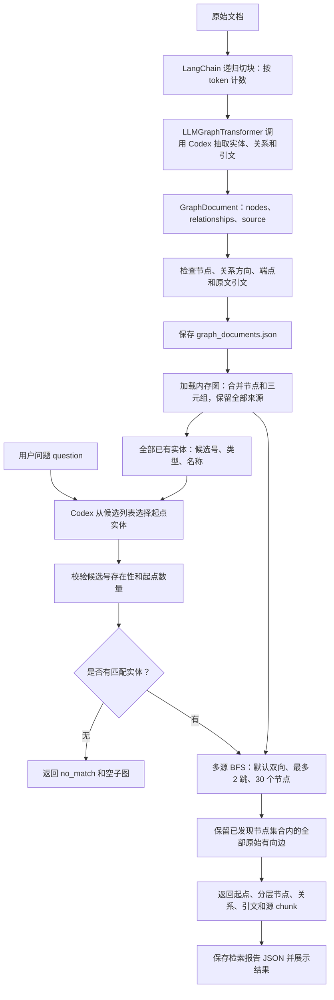
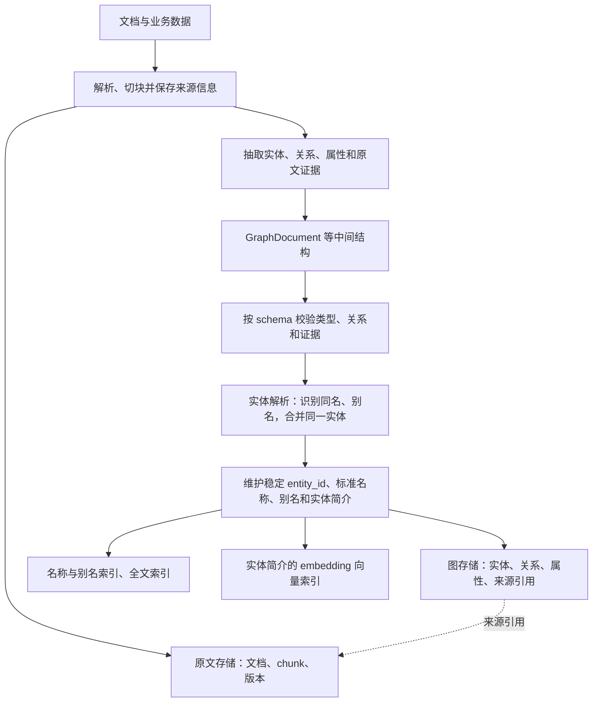
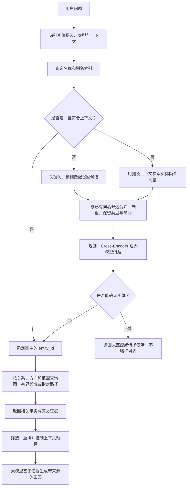

# Graph RAG 流程图

更新日期：2026-10-17。本文保存本项目当前流程，以及讨论中的生产环境扩展设计。Mermaid 代码块可在 GitHub 中直接查看为流程图。

## 当前实现：图文档构建与 BFS 检索

当前用 JSON 持久化 GraphDocument，检索时构建内存邻接表。节点以 `(type, id)` 区分；候选号仅在当前候选列表中使用。尚未接入图数据库、实体向量索引、人工别名表或最终答案生成。

- 建图入口：[`run.py`](../run.py)，主要流程：[`pipeline.py`](../graph_rag/pipeline.py)。
- 检索入口：[`retrieve.py`](../retrieve.py)，实体选择和 BFS：[`retriever.py`](../graph_rag/retriever.py)。
- BFS 的入边、出边或双向设置控制节点发现范围，输出的关系始终保留原方向。节点达到上限时报告截断。
- 子图是候选证据集合，可能含有无关事实；当前没有根据问题筛选关系或生成答案。

## 生产环境扩展：建图与存储设计

以下是设计方案，尚未实现。三元组是“主体—关系—客体”，例如“张三—负责—知识助手项目”；GraphDocument 是中间结构，生成该对象不等于已经写入图数据库。

图、检索索引和原文存储是逻辑职责，不必分别部署三个数据库。属性图可使用 Neo4j，RDF 图可使用 GraphDB；Amazon Neptune 支持属性图与 RDF。Neo4j 也可以在图数据库内维护全文索引和向量索引。

实体向量应表达名称、类型、别名和必要背景，例如“张三，研发部工程师，负责知识助手项目”。语义相似只用于召回可能的对象，不能直接证明实体身份相同。

## 生产环境扩展：大量实体下的对齐与检索设计

以下流程将当前“全量实体交给模型”改为“候选召回后消歧”。候选数量根据数据与评估确定；精确匹配存在同名对象时也需要消歧。

实体对齐同时发生在建图与查询阶段：建图时避免同一对象被拆成多个节点，查询时把用户的提及链接到已有实体 ID。LangChain 可负责接口编排；关系遍历由程序或数据库查询执行。

## 参考

- [Neo4j 图模型与 Cypher](https://neo4j.com/docs/getting-started/cypher/)。
- [Neo4j 全文与向量索引](https://neo4j.com/docs/cypher-manual/current/indexes/search-indexes/)。
- [Amazon Neptune 图模型与查询语言](https://docs.aws.amazon.com/neptune/latest/userguide/access-graph-queries.html)。
- [GraphDB 与 RDF](https://www.ontotext.com/knowledgehub/fundamentals/graphdb-fundamentals/)。
- [Bi-Encoder 候选召回与 Cross-Encoder 消歧论文](https://aclanthology.org/2020.emnlp-main.519/)。
